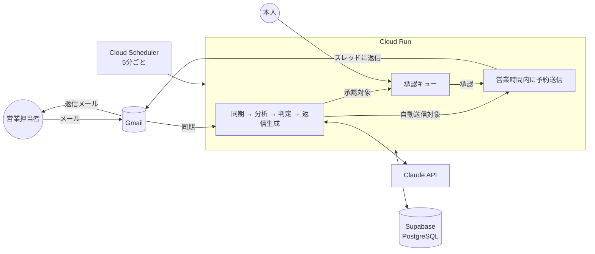

# エージェントエージェント(AgentAgent)

フリーランスエンジニアのための、フリーランスエージェント(案件紹介会社)対応 AI エージェントです。

エージェントの営業担当者から届くメール(案件紹介、状況確認、面談調整、単価交渉、契約手続き)を AI が本人に代わって読み、本人のプロフィールと方針に沿った返信を本人名義で送ります。全エージェントとのやり取り、案件の進捗、承認が必要な返信を一つの画面で管理できます。

Google Cloud Run と Supabase で 24 時間クラウドで動かす構成を標準としています。手元の PC は不要です。

## 主な機能

- **Gmail 連携**: 受信メールを 5 分ごとに取り込み、エージェントからのメールを自動で判別。未知の送信者は AI が判定してエージェントと担当者を自動登録
- **AI による分析**: 12 カテゴリへの分類、要約、案件情報(単価、期間、勤務地、リモート可否、スキル)の抽出、希望条件との適合度の算出
- **AI による返信生成**: 本人のプロフィール、署名、文体、追加指示に基づく日本語ビジネスメール。AI であることは相手に示しません
- **運用モード**: 「自動返信 + 重要案件のみ承認」(既定)、「全件承認」、「完全自動」。単価交渉、契約、面談確定、辞退、日程確定などは既定で承認制
- **人間らしい送信タイミング**: 受信から 20〜90 分のランダム遅延、営業時間内のみ送信、週末は翌営業日
- **一元管理ダッシュボード**: 受信箱、承認キュー、案件パイプライン、エージェント台帳、活動ログ、設定
- **安全装置**: 自動応答メールの検知、スレッドごとの自動返信上限、信頼度の閾値、新規エージェントへの初回返信の承認、本人が Gmail から返信した場合の返信案の自動取消、古いメールへの返信の承認制

## 仕組み



| ドキュメント | 内容 |
| --- | --- |
| [docs/05_cloud_deployment.md](docs/05_cloud_deployment.md) | **クラウド運用手順**(Cloud Run + Supabase のセットアップ、費用、運用、トラブルシューティング) |
| [docs/01_requirements.md](docs/01_requirements.md) | 要件定義(ユースケース、機能要件、非機能要件、受け入れ基準) |
| [docs/02_architecture.md](docs/02_architecture.md) | アーキテクチャ、処理フロー、データモデル、環境変数 |
| [docs/03_ai_design.md](docs/03_ai_design.md) | AI の設計(分類、出力スキーマ、判定ロジック、プロンプト方針、安全策、コスト) |
| [docs/04_ui_screens.md](docs/04_ui_screens.md) | 画面設計 |

## クラウドで動かす(標準)

すべてブラウザで完結します。詳しい手順は [docs/05_cloud_deployment.md](docs/05_cloud_deployment.md) を参照してください。

1. Supabase で東京リージョンのプロジェクトを作り、接続文字列(Transaction pooler と Session pooler)を控える
2. Google Cloud で OAuth 同意画面と OAuth クライアントを作る
3. Google Cloud コンソールの Cloud Shell でこのリポジトリを取得し、セットアップスクリプトを実行する

```bash
git clone https://github.com/shunshun0904/agentagent.git
cd agentagent
bash scripts/gcp/setup.sh
```

4. 表示された URL を開いて Google でログインし、設定画面でプロフィールと返信ポリシーを入力する

セットアップスクリプトは、API の有効化、シークレットの登録、Cloud Run へのデプロイ、5 分ごとの定期実行(Cloud Scheduler)の登録までを行います。個人利用の範囲なら Google Cloud と Supabase は無料枠に収まる見込みで、Claude API の利用料(メール 1 通あたり約 0.05 ドル)が主な費用です。

| 作業 | コマンド(Cloud Shell) |
| --- | --- |
| 初回セットアップ・設定変更 | `bash scripts/gcp/setup.sh` |
| コード更新後の再デプロイ | `bash scripts/gcp/deploy.sh` |
| API キーなどの変更 | `bash scripts/gcp/set-secret.sh ANTHROPIC_API_KEY` |

## 技術スタック

| 領域 | 採用技術 |
| --- | --- |
| アプリ | Next.js 16(App Router)/ React 19 / TypeScript / Tailwind CSS 4 |
| DB | PostgreSQL(Supabase)/ Prisma 7 |
| AI | Anthropic SDK(Claude、既定モデル `claude-opus-5-5`) |
| メール | Gmail API(googleapis) |
| 実行環境 | Google Cloud Run(コンテナ)/ Cloud Scheduler / Secret Manager / Cloud Build |
| テスト | Vitest(ユニットテストと、実 DB を使う結合テスト) |

## ローカルで開発する

コードを変更する場合の手順です。運用には不要です。

```bash
npm install                 # postinstall で Prisma Client を生成
cp .env.example .env        # 値を設定(下記)
docker compose up -d        # ローカルに PostgreSQL を起動
npm run db:migrate          # マイグレーションを適用
npm run dev                 # http://localhost:3000
```

Gmail や API キーなしで画面だけ確認する場合は、`.env` に `DEV_LOGIN_ENABLED="true"` を設定して `npm run db:seed` を実行し、ログイン画面の「デモユーザーでログイン」から入ります。デモデータの会社名・人名・メールアドレスはすべて架空です。開発用ログインは本番環境では無効です。

ローカルで Gmail 連携まで試す場合は、OAuth クライアントのリダイレクト URI に `http://localhost:3000/api/auth/google/callback` を追加し、`.env` に `GOOGLE_CLIENT_ID`、`GOOGLE_CLIENT_SECRET`、`ANTHROPIC_API_KEY`、`APP_ENCRYPTION_KEY`(`openssl rand -base64 32` で生成)を設定します。

| コマンド | 内容 |
| --- | --- |
| `npm run dev` | 開発サーバー |
| `npm run build` / `npm start` | 本番ビルドと起動 |
| `npm run worker` | 定期処理のワーカー(クラウドでは Cloud Scheduler が代わりに動かす) |
| `npm test` | ユニットテスト |
| `npm run test:integration` | 結合テスト(`INTEGRATION_DATABASE_URL` にマイグレーション済みの DB を指定) |
| `npm run lint` / `npm run typecheck` | ESLint / TypeScript |
| `npm run db:migrate` / `npm run db:deploy` | マイグレーション(開発 / 本番) |
| `npm run db:seed` | デモデータの投入 |
| `docker build -t agentagent .` | Cloud Run と同じコンテナイメージのビルド |

## 運用の考え方

- **最初は「全件承認」で始める**ことを勧めます。承認キューで AI の返信案の品質を確認し、プロフィールや「AI への追加指示」を調整してから「自動返信 + 重要案件のみ承認」に切り替えます。
- 返信案は本文を編集してから承認できます。編集した内容を設定画面の「過去に自分で書いたメールのサンプル」に追記すると文体が近づきます。
- エージェントごとに「自動返信を無効」「常に承認」「一時停止」「ブロック」を設定できます。スレッド単位で自動返信を停止(ミュート)することもできます。
- すべての AI の判定と送信は活動ログに残ります。返信案にはモデル、プロンプトのバージョン、トークン使用量が保存されます。

## セキュリティ

- ログインできるのは `ALLOWED_GOOGLE_EMAILS` に登録したアカウントだけです。本番環境で未設定の場合は誰もログインできません
- OAuth のトークンは AES-256-GCM で暗号化して保存します。クラウドでは秘密情報をすべて Secret Manager に保存します
- セッションは HTTP only Cookie で、DB にはトークンのハッシュのみ保存します
- 定期実行のエンドポイント(`/api/cron/tick`)は `CRON_SECRET` が一致しない限り拒否します
- Supabase では全テーブルで行レベルセキュリティ(RLS)を有効にし、Data API からは読めないようにしています
- Gmail の `gmail.modify` スコープは受信メールの読み取りと送信に使います。メールの完全削除はできません

## 制限事項と今後の拡張

- 対応チャネルは Gmail のみ(Chatwork、Slack、LINE は未対応)
- 1 ユーザー(本人)での利用を想定。マルチユーザー対応はデータモデル上は可能ですが画面と権限は未整備
- Gmail の取り込みは 5 分ごとのポーリング。Pub/Sub による即時通知は未実装
- カレンダー連携による面談枠の自動確定、スキルシートの自動添付は未実装
- 結合テストは Gmail API と Claude API を偽物に差し替えて実施しています。実際の API を使った自動テストは含まれていません

## ライセンス

未定(リポジトリ所有者が決定してください)。
