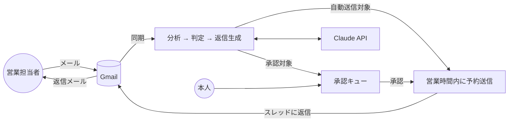

# エージェントエージェント(AgentAgent)

フリーランスエンジニアのための、フリーランスエージェント(案件紹介会社)対応 AI エージェントです。

エージェントの営業担当者から届くメール(案件紹介、状況確認、面談調整、単価交渉、契約手続き)を AI が本人に代わって読み、本人のプロフィールと方針に沿った返信を本人名義で送ります。全エージェントとのやり取り、案件の進捗、承認が必要な返信を一つの画面で管理できます。

## 主な機能

- **Gmail 連携**: 受信メールを定期的に取り込み、エージェントからのメールを自動で判別。未知の送信者は AI が判定してエージェントと担当者を自動登録
- **AI による分析**: 12 カテゴリへの分類、要約、案件情報(単価、期間、勤務地、リモート可否、スキル)の抽出、希望条件との適合度の算出
- **AI による返信生成**: 本人のプロフィール、署名、文体、追加指示に基づく日本語ビジネスメール。AI であることは相手に示しません
- **運用モード**: 「自動返信 + 重要案件のみ承認」(既定)、「全件承認」、「完全自動」。単価交渉、契約、面談確定、辞退、日程確定などは既定で承認制
- **人間らしい送信タイミング**: 受信から 20〜90 分のランダム遅延、営業時間内のみ送信、週末は翌営業日
- **一元管理ダッシュボード**: 受信箱、承認キュー、案件パイプライン、エージェント台帳、活動ログ、設定
- **安全装置**: 自動応答メールの検知、スレッドごとの自動返信上限、信頼度の閾値、新規エージェントへの初回返信の承認、本人が Gmail から返信した場合の返信案の自動取消

## 仕組み



詳細は `docs/` を参照してください。

| ドキュメント | 内容 |
| --- | --- |
| [docs/01_requirements.md](docs/01_requirements.md) | 要件定義(ユースケース、機能要件、非機能要件、受け入れ基準) |
| [docs/02_architecture.md](docs/02_architecture.md) | アーキテクチャ、処理フロー、データモデル、デプロイ、環境変数 |
| [docs/03_ai_design.md](docs/03_ai_design.md) | AI の設計(分類、出力スキーマ、判定ロジック、プロンプト方針、安全策、コスト) |
| [docs/04_ui_screens.md](docs/04_ui_screens.md) | 画面設計 |

## 技術スタック

Next.js 16(App Router)/ React 19 / TypeScript / Tailwind CSS 4 / Prisma 7 / PostgreSQL 16 / Gmail API(googleapis)/ Anthropic SDK(Claude、既定モデル `claude-opus-5-5`)/ Vitest

## セットアップ

### 前提

- Node.js 22 以上
- PostgreSQL 16(Docker を使う場合は `docker compose` で起動できます)
- Google Cloud のプロジェクト(Gmail API)
- Anthropic API キー

### 1. 依存関係のインストール

```bash
npm install
```

`postinstall` で Prisma クライアントが `src/generated/prisma` に生成されます。

### 2. 環境変数

```bash
cp .env.example .env
```

`.env` を編集します。必須の項目:

| 変数 | 内容 |
| --- | --- |
| `DATABASE_URL` | PostgreSQL の接続文字列(docker compose を使う場合は既定値のまま) |
| `APP_URL` | アプリの URL(ローカルは `http://localhost:3000`) |
| `APP_ENCRYPTION_KEY` | OAuth トークン暗号化の鍵。`openssl rand -base64 32` で生成 |
| `GOOGLE_CLIENT_ID` / `GOOGLE_CLIENT_SECRET` | 下記「Google Cloud の設定」で取得 |
| `ANTHROPIC_API_KEY` | Anthropic API キー |
| `ALLOWED_GOOGLE_EMAILS` | ログインを許可する自分の Gmail アドレス(推奨) |
| `CRON_SECRET` | cron エンドポイントを使う場合。`openssl rand -hex 32` で生成 |

### 3. Google Cloud の設定

1. [Google Cloud Console](https://console.cloud.google.com/) でプロジェクトを作成する
2. 「API とサービス」→「ライブラリ」で **Gmail API** を有効にする
3. 「OAuth 同意画面」を設定する(ユーザーの種類は「外部」)。テストユーザーに自分の Gmail アドレスを追加し、スコープに `https://www.googleapis.com/auth/gmail.modify` を追加する
4. 「認証情報」→「認証情報を作成」→「OAuth クライアント ID」(種類: ウェブアプリケーション)を作成する。承認済みのリダイレクト URI に `http://localhost:3000/api/auth/google/callback`(本番は `${APP_URL}/api/auth/google/callback`)を登録する
5. 表示されたクライアント ID とクライアントシークレットを `.env` に設定する

注意: OAuth 同意画面の公開ステータスが「テスト」のままだと、Google の仕様によりリフレッシュトークンが 7 日で失効し、再連携が必要になります。継続して使う場合は公開ステータスを「本番環境」にしてください(自分だけが使う場合、アプリの検証を受けなくても利用できますが、ログイン時に未検証アプリの警告画面が表示されます)。

### 4. データベース

```bash
docker compose up -d        # ローカルに PostgreSQL を起動(任意)
npm run db:migrate          # マイグレーションを適用
```

### 5. 起動

```bash
npm run dev                 # http://localhost:3000
```

ブラウザで開き、「Google でログイン」から Gmail を連携します。ログイン後、設定画面で **プロフィール**(スキル、希望単価、稼働状況、面談可能な時間帯、署名)と **返信ポリシー** を入力してください。AI はこの内容に基づいて返信を書きます。

### 6. バックグラウンド処理

同期と送信を定期的に実行するため、次のいずれかを使います。

```bash
npm run worker              # 常駐ワーカー(既定 5 分間隔。SYNC_INTERVAL_SECONDS で変更)
```

または外部 cron から `GET /api/cron/tick` を `Authorization: Bearer ${CRON_SECRET}` 付きで呼び出します(Vercel Cron など)。画面左下の「今すぐ同期」でも手動実行できます。

### デモデータで試す(Gmail や API キーなしで画面を確認)

```bash
# .env に DEV_LOGIN_ENABLED="true" を設定
npm run db:seed             # 架空のエージェント・メール・返信案・案件を投入
npm run dev                 # /login の「デモユーザーでログイン」から入る
```

デモデータの会社名・人名・メールアドレスはすべて架空です。開発用ログインは本番ビルドでは無効です。

## 開発コマンド

| コマンド | 内容 |
| --- | --- |
| `npm run dev` | 開発サーバー |
| `npm run build` / `npm start` | 本番ビルドと起動 |
| `npm run worker` | バックグラウンドワーカー |
| `npm test` | ユニットテスト(Vitest) |
| `npm run lint` / `npm run typecheck` | ESLint / TypeScript |
| `npm run db:migrate` / `npm run db:deploy` | マイグレーション(開発 / 本番) |
| `npm run db:studio` | Prisma Studio |
| `npm run db:seed` | デモデータの投入(デモユーザーのデータを作り直す) |

## 運用の考え方

- **最初は「全件承認」で始める**ことを勧めます。承認キューで AI の返信案の品質を確認し、プロフィールや「AI への追加指示」を調整してから「自動返信 + 重要案件のみ承認」に切り替えます。
- 返信案は本文を編集してから承認できます。編集した内容は本人の文体として参考にできるので、設定画面の「過去に自分で書いたメールのサンプル」に追記すると文体が近づきます。
- エージェントごとに「自動返信を無効」「常に承認」「一時停止」「ブロック」を設定できます。
- スレッド単位で自動返信を停止(ミュート)できます。
- すべての AI の判定と送信は活動ログに残ります。返信案にはモデル、プロンプトのバージョン、トークン使用量が保存されます。

## セキュリティ

- OAuth のトークンは AES-256-GCM で暗号化して保存します(鍵は `APP_ENCRYPTION_KEY`)
- セッションは HTTP only Cookie。DB にはトークンのハッシュのみ保存します
- `ALLOWED_GOOGLE_EMAILS` でログインできるアカウントを自分のものに限定してください
- `/api/cron/tick` は `CRON_SECRET` が未設定なら常に拒否します
- Gmail の `gmail.modify` スコープは受信メールの読み取りと送信に使います。メールの完全削除はできません

## 制限事項と今後の拡張

- 対応チャネルは Gmail のみ(Chatwork、Slack、LINE は未対応)
- 1 ユーザー(本人)での利用を想定。マルチユーザー対応はデータモデル上は可能ですが画面と権限は未整備
- Gmail の取り込みはポーリング(5 分間隔)。Pub/Sub による即時通知は未実装
- カレンダー連携による面談枠の自動確定、スキルシートの自動添付は未実装
- Gmail API と Claude API を使った結合テストは含まれていません(純粋ロジックのユニットテストのみ)

## ライセンス

未定(リポジトリ所有者が決定してください)。
