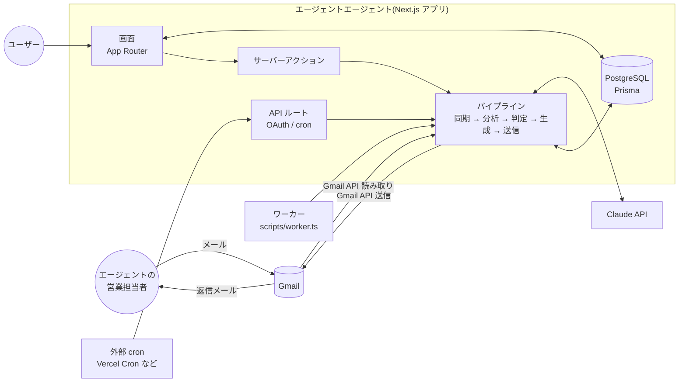
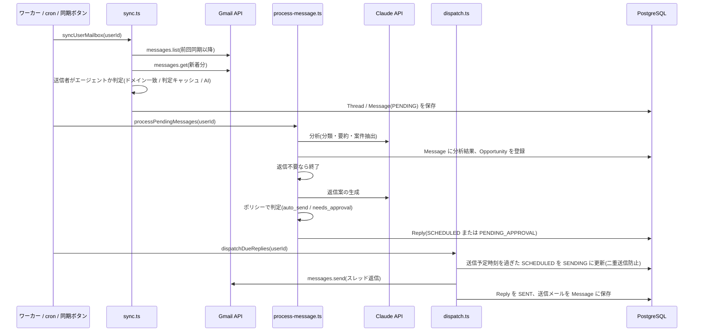
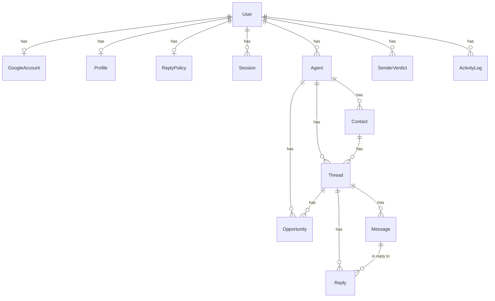

# アーキテクチャ設計

最終更新: 2026-10-09

## 1. 全体構成



単一の Next.js アプリケーションに、画面、API、ビジネスロジックをまとめている。バックグラウンド処理(同期と送信)は同じコードを「ワーカープロセス」「cron エンドポイント」「画面の同期ボタン」の3通りの入口から呼び出せる。

## 2. 技術スタック

| 領域 | 採用技術 | 備考 |
| --- | --- | --- |
| フレームワーク | Next.js 16(App Router、Turbopack)、React 19、TypeScript | 画面はサーバーコンポーネント中心。フォーム操作はサーバーアクション |
| スタイル | Tailwind CSS 4 | `src/app/globals.css` に共通部品(`.input` `.btn-*`)を定義 |
| DB | PostgreSQL 16、Prisma 7(`prisma-client` ジェネレータ + `@prisma/adapter-pg`) | クライアントは `src/generated/prisma` に生成(git 管理外) |
| メール | Gmail API(`googleapis`) | OAuth 2.0、スコープ `gmail.modify` |
| AI | Anthropic SDK(`@anthropic-ai/sdk`)、構造化出力(zod) | 既定モデル `claude-opus-5-5`。詳細は `03_ai_design.md` |
| テスト | Vitest | 純粋ロジック(判定、送信時刻、MIME、メール解析)を対象 |
| 実行 | Node.js 22 | ワーカーは `tsx` で実行 |

## 3. ディレクトリ構成

```
prisma/
  schema.prisma          データモデル
  migrations/            マイグレーション
scripts/
  worker.ts              バックグラウンドワーカー
  seed.ts                デモデータ投入
src/
  app/
    (app)/               ログイン必須の画面(ダッシュボード、受信箱、承認キュー、案件、エージェント、設定、活動ログ)
    login/               ログイン画面
    api/auth/google/     Google OAuth の開始とコールバック
    api/auth/dev/        開発用ログイン(本番では無効)
    api/auth/logout/
    api/cron/tick/       外部 cron から呼ぶエンドポイント
    api/health/
  actions/               サーバーアクション(返信案の承認、スレッド操作、設定保存など)
  components/            画面部品
  lib/
    env.ts               環境変数の検証
    db.ts                Prisma クライアント(遅延初期化)
    crypto.ts            トークンの暗号化(AES-256-GCM)
    auth/                セッション、Google OAuth、ログイン処理
    gmail/               Gmail クライアント、メール解析、MIME 組み立て、同期、送信
    ai/                  スキーマ、プロンプト、Claude 呼び出し
    policy/              既定値、返信判定、送信時刻計算
    pipeline/            メール処理、送信、tick(全体の実行)
tests/                   ユニットテスト
docs/                    設計ドキュメント
```

## 4. 処理フロー



### 4.1 同期(`src/lib/gmail/sync.ts`)

- クエリは既定で `-in:spam -in:trash -in:chats`。初回は `newer_than:{GMAIL_SYNC_LOOKBACK_DAYS}d`、2回目以降は前回同期時刻の1時間前から(`after:`)。重複はメール ID で除外する。
- 送信者の判定順序: 既知のスレッド → 既知エージェントのドメイン → 送信者判定キャッシュ(`SenderVerdict`) → 一斉配信や自動送信アドレスは除外 → AI による判定。AI 判定は1回の同期で `SENDER_CHECKS_PER_SYNC` 件まで。上限を超えた分は次回の同期で再判定されるよう、同期開始位置を戻す。
- AI がエージェントと判定した送信者は、エージェントと担当者を自動登録する。
- 本人が Gmail から手動で送ったメールも取り込み、そのスレッドの未送信の返信案を取り消す(二重返信の防止)。
- 相手から新しいメールが届いたスレッドでは、古いメールへの未送信返信案を取り消し、新しいメールに対して返信案を作り直す。

### 4.2 分析と返信案の生成(`src/lib/pipeline/process-message.ts`)

1. 分析(分類、要約、案件情報、質問、候補日時、期限)
2. 案件の登録(同じスレッド内の同名案件は更新)
3. 返信しない条件の事前判定(返信不要、返信しないカテゴリ、ミュート、ブロック、自動応答メール)。該当すれば返信案を生成しない
4. 返信案の生成
5. ポリシーによる判定。自動送信なら送信予定時刻を計算して `SCHEDULED`、それ以外は `PENDING_APPROVAL`
6. スレッドの要約とステータスを更新

失敗したメールは `ERROR` として記録し、スレッドを「要対応」にする。画面の「再処理」ボタンで再実行できる。

### 4.3 送信(`src/lib/pipeline/dispatch.ts`)

- `SCHEDULED` かつ送信予定時刻を過ぎた返信案を送る。`updateMany` で `SENDING` に遷移できた1件だけを送信するため、ワーカーと cron が同時に動いても二重送信しない。
- 返信先は元メールの送信者。ポリシーの「全員に返信」が有効なら、元メールの宛先と CC(自分と送信者を除く)を CC に入れる。
- `In-Reply-To` と `References` を設定し、Gmail の `threadId` を指定して同じスレッドに入れる。
- 送信したメールは `Message`(OUTBOUND)として保存する。同期が先に取り込んでいた場合に備えて upsert する。

## 5. データモデル



| モデル | 役割 | 主な項目 |
| --- | --- | --- |
| User | ユーザー | email |
| Session | ログインセッション | tokenHash(Cookie のハッシュ)、expiresAt |
| GoogleAccount | Gmail 連携 | 暗号化したリフレッシュトークン、lastSyncedAt、lastSyncError |
| Profile | AI が参照する本人情報 | 氏名、スキル、希望単価、稼働状況、稼働形態、NG 条件、面談可能時間帯、署名、文体 |
| ReplyPolicy | 返信ポリシー | mode、承認カテゴリ、返信しないカテゴリ、承認コミットメント、信頼度閾値、営業時間、遅延、追加指示 |
| Agent | エージェント会社 | name、domains、status(有効/一時停止/ブロック)、autoReplyEnabled、requireApproval、notes |
| Contact | 担当者 | email(ユーザー内で一意)、name、role |
| SenderVerdict | 送信者判定のキャッシュ | email、kind(AGENT/NOT_AGENT) |
| Thread | Gmail スレッド | gmailThreadId、status、lastCategory、summary(AI の要約) |
| Message | メール1通 | direction、本文(引用除去済み)、RFC ヘッダー、分析結果(category、confidence、extracted) |
| Reply | 返信案 | status、decision、decisionReasons、commitments、riskFlags、scheduledFor、modelId、promptVersion、usage |
| Opportunity | 案件 | title、単価、期間、場所、リモート、stage、fitScore、interviewAt |
| ActivityLog | 活動ログ | type、message、entityType/entityId |

ステータスの遷移:

- Thread: `OPEN`(相手からの受信あり)→ `NEEDS_ACTION`(承認待ちや失敗)→ `WAITING_THEM`(こちらが送信済み)→ `CLOSED` / `ARCHIVED`
- Reply: `PENDING_APPROVAL` → (承認)→ `SCHEDULED` → `SENDING` → `SENT`。却下は `REJECTED`、取消は `CANCELLED`、送信失敗は `FAILED`(再承認で再送可能)

## 6. バックグラウンド処理の実行方法

| 方法 | 用途 | 仕組み |
| --- | --- | --- |
| ワーカープロセス `npm run worker` | VPS や Docker で常駐させる場合 | `SYNC_INTERVAL_SECONDS` ごとに全ユーザー分の tick を実行 |
| cron エンドポイント `GET /api/cron/tick` | Vercel などサーバーレスで動かす場合 | `Authorization: Bearer ${CRON_SECRET}` または `x-cron-secret` ヘッダーで認証 |
| 画面の「今すぐ同期」ボタン | 手動実行 | サーバーアクションから tick を実行し、活動ログへ遷移 |

3つとも `runTick(userId)`(`src/lib/pipeline/tick.ts`)を呼ぶ。同期、処理、送信の各段階は独立して例外を捕捉するため、Gmail 未連携でも処理と送信は実行される。

## 7. 認証とセキュリティ

- ログインは Google OAuth のみ。`ALLOWED_GOOGLE_EMAILS` で許可するアカウントを限定できる。
- セッションはランダムトークンを HTTP only Cookie(`aa_session`、30日)に入れ、DB には SHA-256 ハッシュのみ保存する。
- OAuth のリフレッシュトークンとアクセストークンは `APP_ENCRYPTION_KEY` から導出した鍵で AES-256-GCM 暗号化して保存する。
- cron エンドポイントは `CRON_SECRET` が未設定なら常に 401 を返す。
- 開発用ログイン(`/api/auth/dev`)は `NODE_ENV` が production 以外かつ `DEV_LOGIN_ENABLED=true` のときのみ有効。
- サーバーアクションはすべて `requireUser()` でログインを確認し、操作対象がそのユーザーのものであることを DB で確認する。
- OAuth の `state` は Cookie に保存して検証する。

## 8. デプロイ構成

### 8.1 VPS / Docker(推奨)

- `npm run build` → `npm start` で Web を起動し、別プロセスで `npm run worker` を常駐させる。
- PostgreSQL は `docker-compose.yml` または外部のマネージド DB。
- 環境変数は `.env.example` を参照。

### 8.2 Vercel + 外部 PostgreSQL

- `postinstall` で Prisma クライアントが生成される。
- `vercel.json` に cron を設定し、`/api/cron/tick` を5分間隔などで呼ぶ。Vercel Cron は `CRON_SECRET` 環境変数を設定すると `Authorization: Bearer` ヘッダーを自動で付ける。
- 1回の tick の実行時間は `maxDuration = 60` 秒に収まるよう、同期する件数や処理件数を環境変数で調整する。

## 9. 環境変数

| 変数 | 必須 | 説明 |
| --- | --- | --- |
| DATABASE_URL | 必須 | PostgreSQL の接続文字列 |
| APP_URL | 必須 | アプリの公開 URL(OAuth リダイレクトに使用) |
| APP_ENCRYPTION_KEY | 必須 | トークン暗号化の鍵(16文字以上) |
| GOOGLE_CLIENT_ID / GOOGLE_CLIENT_SECRET | Gmail 連携に必須 | Google Cloud の OAuth クライアント |
| ALLOWED_GOOGLE_EMAILS | 推奨 | ログインを許可するメール(カンマ区切り) |
| ANTHROPIC_API_KEY | AI 機能に必須 | Anthropic API キー |
| AGENTAGENT_MODEL | 任意 | 既定 `claude-opus-5-5` |
| AGENTAGENT_DRAFT_EFFORT / AGENTAGENT_ANALYSIS_EFFORT | 任意 | 既定 `medium` / `low` |
| CRON_SECRET | cron 利用時に必須 | cron エンドポイントの認証 |
| DEV_LOGIN_ENABLED | 任意 | 開発用ログインの有効化 |
| GMAIL_SYNC_QUERY / GMAIL_SYNC_LOOKBACK_DAYS / GMAIL_SYNC_MAX_MESSAGES / SENDER_CHECKS_PER_SYNC | 任意 | 同期の調整 |
| SYNC_INTERVAL_SECONDS | 任意 | ワーカーの実行間隔(既定 300) |

## 10. 設計上の判断

| 判断 | 理由 |
| --- | --- |
| Gmail はポーリング(push 通知を使わない) | Pub/Sub の設定が不要で、cron でもワーカーでも同じコードで動く。5分間隔でも返信は営業時間内の遅延送信なので体感上の差はない |
| 分析と返信生成を2回の呼び出しに分ける | 返信不要なメール(一斉配信など)で返信生成のコストを払わない。分析結果を UI に表示し、判定の根拠を残せる |
| 判定ロジックを AI ではなくコードで持つ | 「単価に言及したら承認」などの規則を決定的に適用でき、テストできる。AI は「返信にどんな約束が含まれるか」を構造化して申告するだけ |
| PostgreSQL のみ対応 | Prisma は接続先の種類をスキーマに固定する必要がある。列挙型や配列型を使うため SQLite との両対応はしない。ローカル開発は docker compose で PostgreSQL を起動する |
| 構造化出力(JSON スキーマ) | 分類やコミットメントを列挙型として確実に受け取り、パース失敗をなくす |
| フォーム送信はサーバーアクション | クライアント JS を最小限にし、ページ全体をサーバーで描画する。操作後は `revalidatePath` で再描画 |
| 送信は `updateMany` による claim | 複数プロセスから送信処理が走っても1件につき1回しか送らない |
