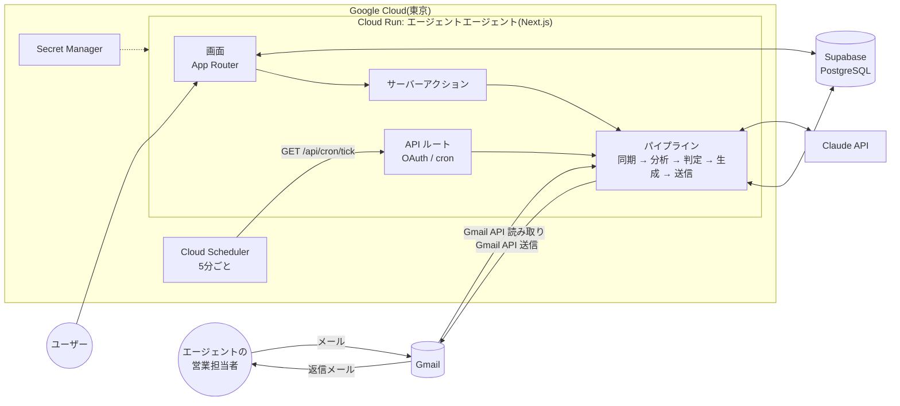
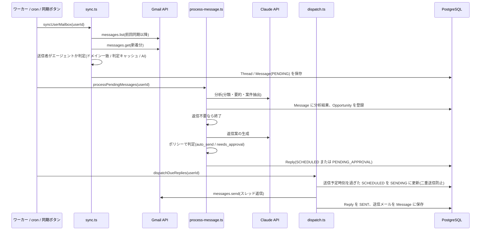
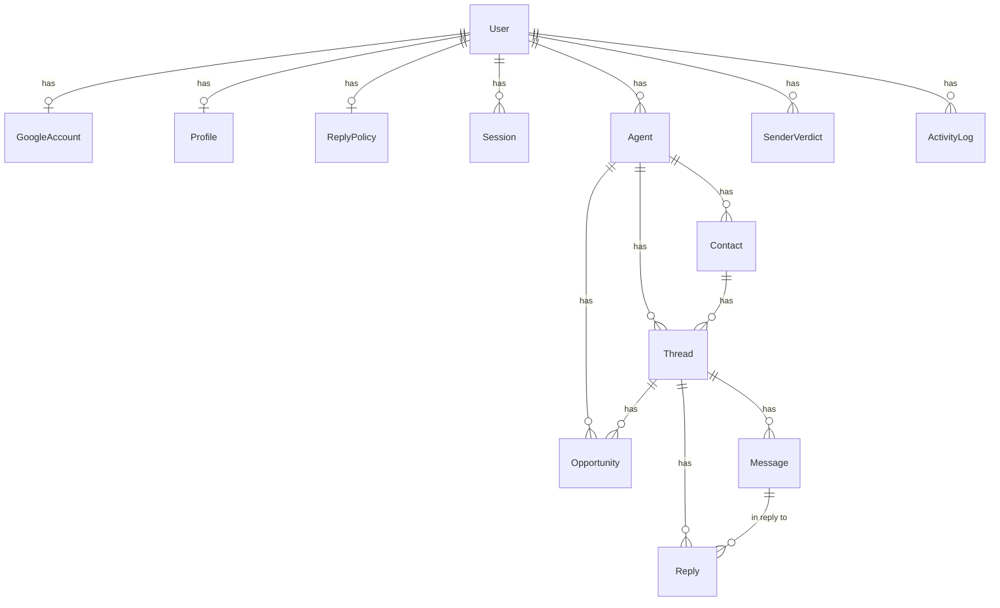

# アーキテクチャ設計

最終更新: 2026-10-10

## 1. 全体構成



単一の Next.js アプリケーションに、画面、API、ビジネスロジックをまとめ、1つのコンテナとして Cloud Run で動かす。定期処理(同期・分析・送信)は Cloud Scheduler が 5 分ごとに cron エンドポイントを呼んで実行する。同じ処理は画面の「今すぐ同期」ボタンと、ローカル開発用のワーカープロセスからも呼び出せる。セットアップと運用手順は `05_cloud_deployment.md` を参照。

## 2. 技術スタック

| 領域 | 採用技術 | 備考 |
| --- | --- | --- |
| フレームワーク | Next.js 16(App Router、Turbopack)、React 19、TypeScript | 画面はサーバーコンポーネント中心。フォーム操作はサーバーアクション。`output: "standalone"` でコンテナ化 |
| スタイル | Tailwind CSS 4 | `src/app/globals.css` に共通部品(`.input` `.btn-*`)を定義 |
| DB | PostgreSQL(本番は Supabase)、Prisma 7(`prisma-client` ジェネレータ + `@prisma/adapter-pg`) | クライアントは `src/generated/prisma` に生成(git 管理外) |
| メール | Gmail API(`googleapis`) | OAuth 2.0、スコープ `gmail.modify` |
| AI | Anthropic SDK(`@anthropic-ai/sdk`)、構造化出力(zod) | 既定モデル `claude-opus-5-5`。詳細は `03_ai_design.md` |
| 実行環境 | Cloud Run、Cloud Scheduler、Secret Manager、Cloud Build、Artifact Registry | 東京リージョン(asia-northeast1) |
| テスト | Vitest | 純粋ロジックのユニットテストと、実 DB で偽の Gmail・AI を使う結合テスト |
| 実行 | Node.js 22 | ワーカーとシードは `tsx` で実行 |

## 3. ディレクトリ構成

```
Dockerfile               Cloud Run 用のコンテナイメージ
docker/
  entrypoint.sh          起動時にマイグレーションを適用してからサーバーを起動
  migrate/package.json   マイグレーション用の Prisma CLI
prisma/
  schema.prisma          データモデル
  migrations/            マイグレーション(RLS の有効化を含む)
scripts/
  gcp/setup.sh           Google Cloud のセットアップ(Cloud Shell で実行)
  gcp/deploy.sh          再デプロイ
  gcp/set-secret.sh      シークレットの変更
  gcp/logs.sh            Cloud Run のログ表示
  gcp/dburl.py           Supabase の接続文字列の検査と正規化
  worker.ts              定期処理のワーカー(ローカル開発用)
  seed.ts                デモデータ投入
src/
  app/
    (app)/               ログイン必須の画面(ダッシュボード、受信箱、承認キュー、案件、エージェント、設定、活動ログ)
    login/               ログイン画面
    api/auth/google/     Google OAuth の開始とコールバック
    api/auth/dev/        開発用ログイン(本番では無効)
    api/auth/logout/
    api/cron/tick/       Cloud Scheduler から呼ぶ定期処理のエンドポイント
    api/health/
  actions/               サーバーアクション(返信案の承認、スレッド操作、設定保存など)
  components/            画面部品
  lib/
    env.ts               環境変数の検証
    db.ts                Prisma クライアント(遅延初期化、TLS と接続数の設定)
    lock.ts              定期処理の多重実行を防ぐ期限付きロック
    canonical.ts         APP_URL 以外のホストからのアクセスを APP_URL に寄せる
    crypto.ts            トークンの暗号化(AES-256-GCM)
    auth/                セッション、Google OAuth、ログイン処理
    gmail/               Gmail クライアント、メール解析、MIME 組み立て、同期、送信
    ai/                  スキーマ、プロンプト、Claude 呼び出し
    policy/              既定値、返信判定、送信時刻計算
    pipeline/            メール処理、送信、tick(全体の実行)
tests/                   ユニットテスト
tests/integration/       結合テスト(実 DB、偽の Gmail と AI)
docs/                    設計ドキュメント
```

## 4. 処理フロー



### 4.1 同期(`src/lib/gmail/sync.ts`)

- クエリは既定で `-in:spam -in:trash -in:chats`。初回は `newer_than:{GMAIL_SYNC_LOOKBACK_DAYS}d`、2回目以降は前回同期時刻の1時間前から(`after:`)。重複はメール ID で除外する。
- 送信者の判定順序: 既知のスレッド → 既知エージェントのドメイン → 送信者判定キャッシュ(`SenderVerdict`) → 一斉配信や自動送信アドレスは除外 → AI による判定。AI 判定は1回の同期で `SENDER_CHECKS_PER_SYNC` 件まで。上限を超えた分は次回の同期で再判定されるよう、同期開始位置を戻す。
- AI がエージェントと判定した送信者は、エージェントと担当者を自動登録する。
- 本人が Gmail から手動で送ったメールも取り込み、そのスレッドの未送信の返信案を取り消す(二重返信の防止)。
- 相手から新しいメールが届いたスレッドでは、古いメールへの未送信返信案を取り消し、新しいメールに対して返信案を作り直す。
- 締め切り時刻(tick の時間予算の半分)を過ぎたら新しいメールの取り込みを止める。その場合は同期位置(`lastSyncedAt`)を進めず、次回に同じ範囲を取得して既知の ID を除外し、続きから取り込む。

### 4.2 分析と返信案の生成(`src/lib/pipeline/process-message.ts`)

1. 分析(分類、要約、案件情報、質問、候補日時、期限)
2. 案件の登録(同じスレッド内の同名案件は更新)
3. 同じスレッドに、このメールより新しい送信メール(本人が返信済み)または受信メールがあれば、返信案を作らずに終える
4. 返信しない条件の事前判定(返信不要、返信しないカテゴリ、ミュート、ブロック、自動応答メール)。該当すれば返信案を生成しない
5. 返信案の生成
6. ポリシーによる判定。自動送信なら送信予定時刻を計算して `SCHEDULED`、それ以外は `PENDING_APPROVAL`。受信から `STALE_REPLY_HOURS`(既定 72 時間)以上経ったメールは常に承認制
7. スレッドの要約とステータスを更新

締め切り時刻(tick の時間予算)を過ぎたら次のメールの処理を始めず、残りは次回に回す。

失敗したメールは `ERROR` として記録し、スレッドを「要対応」にする。画面の「再処理」ボタンで再実行できる。

### 4.3 送信(`src/lib/pipeline/dispatch.ts`)

- `SCHEDULED` かつ送信予定時刻を過ぎた返信案を送る。`updateMany` で `SENDING` に遷移できた1件だけを送信するため、ワーカーと cron が同時に動いても二重送信しない。
- 返信先は元メールの送信者。ポリシーの「全員に返信」が有効なら、元メールの宛先と CC(自分と送信者を除く)を CC に入れる。
- `In-Reply-To` と `References` を設定し、Gmail の `threadId` を指定して同じスレッドに入れる。
- 送信したメールは `Message`(OUTBOUND)として保存する。同期が先に取り込んでいた場合に備えて upsert する。

## 5. データモデル



| モデル | 役割 | 主な項目 |
| --- | --- | --- |
| User | ユーザー | email |
| Session | ログインセッション | tokenHash(Cookie のハッシュ)、expiresAt |
| GoogleAccount | Gmail 連携 | 暗号化したリフレッシュトークン、lastSyncedAt、lastSyncError |
| Profile | AI が参照する本人情報 | 氏名、スキル、希望単価、稼働状況、稼働形態、NG 条件、面談可能時間帯、署名、文体 |
| ReplyPolicy | 返信ポリシー | mode、承認カテゴリ、返信しないカテゴリ、承認コミットメント、信頼度閾値、営業時間、遅延、追加指示 |
| Agent | エージェント会社 | name、domains、status(有効/一時停止/ブロック)、autoReplyEnabled、requireApproval、notes |
| Contact | 担当者 | email(ユーザー内で一意)、name、role |
| SenderVerdict | 送信者判定のキャッシュ | email、kind(AGENT/NOT_AGENT) |
| Thread | Gmail スレッド | gmailThreadId、status、lastCategory、summary(AI の要約) |
| Message | メール1通 | direction、本文(引用除去済み)、RFC ヘッダー、分析結果(category、confidence、extracted) |
| Reply | 返信案 | status、decision、decisionReasons、commitments、riskFlags、scheduledFor、modelId、promptVersion、usage |
| Opportunity | 案件 | title、単価、期間、場所、リモート、stage、fitScore、interviewAt |
| ActivityLog | 活動ログ | type、message、entityType/entityId |
| JobLock | 定期処理のロック | name(`tick:ユーザーID`)、holder、lockedUntil |

ステータスの遷移:

- Thread: `OPEN`(相手からの受信あり)→ `NEEDS_ACTION`(承認待ちや失敗)→ `WAITING_THEM`(こちらが送信済み)→ `CLOSED` / `ARCHIVED`
- Reply: `PENDING_APPROVAL` → (承認)→ `SCHEDULED` → `SENDING` → `SENT`。却下は `REJECTED`、取消は `CANCELLED`、送信失敗は `FAILED`(再承認で再送可能)

## 6. バックグラウンド処理の実行方法

| 方法 | 用途 | 仕組み |
| --- | --- | --- |
| Cloud Scheduler → `GET /api/cron/tick` | 本番(標準) | 5 分ごとに呼ぶ。`x-cron-secret` ヘッダー(または `Authorization: Bearer`)を `CRON_SECRET` と照合 |
| 画面の「今すぐ同期」ボタン | 手動実行 | サーバーアクションから tick を実行し、活動ログへ遷移 |
| ワーカープロセス `npm run worker` | ローカル開発、VPS で常駐させる場合 | `SYNC_INTERVAL_SECONDS` ごとに全ユーザー分の tick を実行 |

3つとも `runTick(userId)`(`src/lib/pipeline/tick.ts`)を呼ぶ。1回の tick は次の順に進む。

1. Gmail 同期(時間予算の半分まで)。新着によって古い返信案が取り消されるため、送信より先に行う
2. 送信予定時刻を過ぎた返信の送信
3. 未処理メールの分析と返信案の作成(時間予算の残りまで)

時間予算は `TICK_TIME_BUDGET_SECONDS`(既定 240 秒)。同じユーザーの tick は `JobLock` テーブルの期限付きロックで同時に1つしか動かず、重なった場合は後から始まった方が何もせずに終わる。ロックの期限は時間予算に 10 分を足した長さで、プロセスが途中で落ちても期限が来れば次の実行が取得できる。各段階は独立して例外を捕捉するため、Gmail 未連携でも処理と送信は実行される。

## 7. 認証とセキュリティ

- ログインは Google OAuth のみ。`ALLOWED_GOOGLE_EMAILS` で許可するアカウントを限定できる。
- セッションはランダムトークンを HTTP only Cookie(`aa_session`、30日)に入れ、DB には SHA-256 ハッシュのみ保存する。
- OAuth のリフレッシュトークンとアクセストークンは `APP_ENCRYPTION_KEY` から導出した鍵で AES-256-GCM 暗号化して保存する。
- cron エンドポイントは `CRON_SECRET` が未設定なら常に 401 を返す。
- 開発用ログイン(`/api/auth/dev`)は `NODE_ENV` が production 以外かつ `DEV_LOGIN_ENABLED=true` のときのみ有効。
- サーバーアクションはすべて `requireUser()` でログインを確認し、操作対象がそのユーザーのものであることを DB で確認する。
- OAuth の `state` は Cookie に保存して検証する。Cloud Run はサービスごとに複数の URL を持つため、ログイン画面と OAuth の開始は `APP_URL` のホストにリダイレクトしてから行い、Cookie とリダイレクト先のドメインをそろえる。
- 本番環境(`NODE_ENV=production`)で `ALLOWED_GOOGLE_EMAILS` が未設定の場合は、誰もログインできない(公開 URL で誰でもログインできる状態を防ぐ)。
- Supabase では全テーブルで行レベルセキュリティ(RLS)を有効にし、ポリシーを作らないことで Data API(anon / authenticated ロール)からの読み書きを拒否する。アプリはテーブル所有者として接続するため影響を受けない。
- 本番の秘密情報(DB 接続文字列、API キー、暗号化キー、cron シークレット)は Secret Manager に保存し、Cloud Run の実行用サービスアカウントにだけ読み取り権限を与える。

## 8. デプロイ構成

### 8.1 Cloud Run + Supabase(標準)

- コンテナは `Dockerfile` からビルドする。Next.js の standalone 出力と、マイグレーション用の Prisma CLI を含む。
- 起動時に `docker/entrypoint.sh` が `prisma migrate deploy` を実行してからサーバーを起動する。複数インスタンスが同時に起動しても、Prisma のマイグレーションは DB のロックで直列化される。
- DB は Supabase の接続プール(Supavisor)を使う。アプリは Transaction pooler(ポート 6543)、マイグレーションは Session pooler(ポート 5432)。Supabase の直接接続は IPv6 専用のため使わない。
- アプリの DB 接続は `DATABASE_SSL=no-verify` で TLS 暗号化する。Supabase の証明書は独自の認証局が発行しており、node-postgres は `sslmode=require` を証明書の完全検証として扱うため、接続文字列の sslmode ではなく `DATABASE_SSL` で制御する。CA 証明書を `DATABASE_CA_CERT` に設定すれば `DATABASE_SSL=verify` で検証まで行える。
- Cloud Run の設定: 東京リージョン、未認証アクセス許可(アプリ側でログインを要求)、CPU 1、メモリ 1 GiB、タイムアウト 900 秒、同時リクエスト 20、インスタンス 0〜2。
- Cloud Scheduler の設定: `*/5 * * * *`(Asia/Tokyo)、試行期限 600 秒。
- セットアップは `scripts/gcp/setup.sh` が行う。手順は `05_cloud_deployment.md`。

### 8.2 その他の環境

- PostgreSQL と Node.js 22 が動く環境なら、`npm run build` → `npm start` で Web を起動し、別プロセスで `npm run worker` を常駐させれば動く。
- 外部の cron サービスから `/api/cron/tick` を呼ぶ構成でもよい。1回の tick は `TICK_TIME_BUDGET_SECONDS` に収まるよう処理を打ち切るため、実行時間に上限がある環境でも使える。

## 9. 環境変数

| 変数 | 必須 | 説明 |
| --- | --- | --- |
| DATABASE_URL | 必須 | PostgreSQL の接続文字列(Supabase は Transaction pooler、ポート 6543) |
| DIRECT_URL | Supabase では必須 | マイグレーション用の接続文字列(Session pooler、ポート 5432、`sslmode=require`) |
| DATABASE_SSL | Supabase では必須 | `no-verify` / `verify` / `disable`。未設定なら接続文字列に従う |
| DATABASE_CA_CERT | 任意 | `DATABASE_SSL=verify` のときの CA 証明書(PEM) |
| DATABASE_POOL_MAX | 任意 | 1 インスタンスあたりの DB 接続数(既定 5) |
| APP_URL | 必須 | アプリの公開 URL(OAuth リダイレクトに使用)。Cloud Run では `https://SERVICE-PROJECT_NUMBER.REGION.run.app` |
| APP_ENCRYPTION_KEY | 必須 | トークン暗号化の鍵(16 文字以上)。変更すると保存済みトークンを復号できなくなる |
| GOOGLE_CLIENT_ID / GOOGLE_CLIENT_SECRET | Gmail 連携に必須 | Google Cloud の OAuth クライアント |
| ALLOWED_GOOGLE_EMAILS | 本番では必須 | ログインを許可するメール(カンマ区切り) |
| ANTHROPIC_API_KEY | AI 機能に必須 | Anthropic API キー |
| AGENTAGENT_MODEL | 任意 | 既定 `claude-opus-5-5` |
| AGENTAGENT_DRAFT_EFFORT / AGENTAGENT_ANALYSIS_EFFORT | 任意 | 既定 `medium` / `low` |
| CRON_SECRET | cron 利用時に必須 | cron エンドポイントの認証 |
| TICK_TIME_BUDGET_SECONDS | 任意 | 1 回の定期処理の時間予算(既定 240 秒) |
| STALE_REPLY_HOURS | 任意 | この時間以上経ったメールへの返信は承認制(既定 72 時間) |
| DEV_LOGIN_ENABLED | 任意 | 開発用ログインの有効化(本番では常に無効) |
| GMAIL_SYNC_QUERY / GMAIL_SYNC_LOOKBACK_DAYS / GMAIL_SYNC_MAX_MESSAGES / SENDER_CHECKS_PER_SYNC | 任意 | 同期の調整(初回の取り込み範囲は既定 7 日) |
| SYNC_INTERVAL_SECONDS | 任意 | ワーカーの実行間隔(既定 300) |
| RUN_MIGRATIONS_ON_START | 任意 | `false` でコンテナ起動時のマイグレーションを止める(既定 `true`) |

## 10. 設計上の判断

| 判断 | 理由 |
| --- | --- |
| Gmail はポーリング(push 通知を使わない) | Pub/Sub の設定が不要で、cron でもワーカーでも同じコードで動く。5分間隔でも返信は営業時間内の遅延送信なので体感上の差はない |
| 分析と返信生成を2回の呼び出しに分ける | 返信不要なメール(一斉配信など)で返信生成のコストを払わない。分析結果を UI に表示し、判定の根拠を残せる |
| 判定ロジックを AI ではなくコードで持つ | 「単価に言及したら承認」などの規則を決定的に適用でき、テストできる。AI は「返信にどんな約束が含まれるか」を構造化して申告するだけ |
| PostgreSQL のみ対応 | Prisma は接続先の種類をスキーマに固定する必要がある。列挙型や配列型を使うため SQLite との両対応はしない。ローカル開発は docker compose で PostgreSQL を起動する |
| 構造化出力(JSON スキーマ) | 分類やコミットメントを列挙型として確実に受け取り、パース失敗をなくす |
| フォーム送信はサーバーアクション | クライアント JS を最小限にし、ページ全体をサーバーで描画する。操作後は `revalidatePath` で再描画 |
| 送信は `updateMany` による claim | 複数プロセスから送信処理が走っても1件につき1回しか送らない |
| 実行環境は Cloud Run | Gmail 連携で Google Cloud プロジェクトが必須なため同じ場所に集約できる。商用利用でき、処理時間の上限が長く(最大 60 分)、個人利用なら無料枠に収まる。Vercel の無料プランは商用利用不可で定期実行が 1 日 1 回までのため採用しない |
| DB は Supabase の無料プラン | 常時稼働で、5 分ごとの定期処理が DB を使うため 1 週間の非アクティブによる一時停止も起きない。Neon の無料プランは月の計算時間の上限があり、5 分間隔で 24 時間動かすと超える |
| ロックは advisory lock ではなく `JobLock` テーブル | Transaction pooler ではセッションをまたいで advisory lock を保持できないため。行の更新は1文で完結し、接続プール経由でも排他できる |
| マイグレーションはコンテナ起動時に実行 | ビルド環境に DB の秘密情報を渡さずに済み、デプロイ手順が1つで済む |
| 時間予算で処理を打ち切る | 1 通あたり AI 呼び出し 2 回で数十秒かかるため、未処理が多いときでも 1 回の実行時間を一定に保つ。残りは次回に回す |
