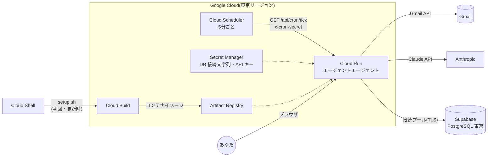

# クラウド運用手順(Google Cloud Run + Supabase)

最終更新: 2026-10-10

この手順で、エージェントエージェントを24時間クラウドで動かします。手元の PC での作業は不要で、すべてブラウザで行います。コマンドの実行はブラウザ上のターミナル(Google Cloud の Cloud Shell)で行います。

## 1. 構成



| 役割 | サービス | 備考 |
| --- | --- | --- |
| アプリ本体(画面・API・定期処理) | Cloud Run | リクエストがある間だけ動く。処理時間の上限は 15 分に設定 |
| 定期実行 | Cloud Scheduler | 5 分ごとに定期処理のエンドポイントを呼ぶ |
| 秘密情報の保管 | Secret Manager | DB 接続文字列、API キー、暗号化キーなど |
| コンテナのビルドと保管 | Cloud Build、Artifact Registry | Dockerfile からビルド。古いイメージは自動削除 |
| データベース | Supabase(無料プラン) | 東京リージョン。接続プール経由で接続 |

## 2. 費用の目安

個人利用(1日数十通のメール)の想定です。Google Cloud の無料枠は請求先アカウント単位で、東京リージョンは無料枠の対象です。

| サービス | 無料枠(月) | この構成での使用量の目安 |
| --- | --- | --- |
| Cloud Run | 200万リクエスト、18万 vCPU 秒、36万 GiB 秒 | 定期実行が月約 8,640 回。処理時間は合計で月 5〜6 万秒程度 |
| Cloud Scheduler | 3 ジョブ | 1 ジョブ |
| Cloud Build | 2,500 ビルド分 | 1 回のデプロイで数分 |
| Artifact Registry | 0.5 GB | 最新 3 イメージを保持。超過分は 1 GB あたり月 0.10 ドル |
| Secret Manager | 有効なバージョン 6 個、アクセス 1 万回 | 6 個を使用。アクセス回数が超えても 1 万回あたり 0.03 ドル |
| Supabase | 無料プラン(DB 500 MB) | 無料 |
| Claude API | 無料枠なし(従量課金) | メール 1 通あたり約 0.05 ドル(`03_ai_design.md` 参照) |

Google Cloud の利用には請求先アカウント(クレジットカード)の登録が必要です。無料枠内なら請求は発生しません。予算アラート(「お支払い」→「予算とアラート」)を設定しておくと安心です。

## 3. 事前に用意するもの

- Google アカウント(連携する Gmail のアカウント)
- Google Cloud のプロジェクト(請求先アカウントを設定済み)
- Supabase のアカウント
- Anthropic の API キー(<https://console.anthropic.com/>)
- このリポジトリへのアクセス(非公開リポジトリの場合は GitHub の Personal access token)

## 4. Supabase のデータベースを作る

1. Supabase のダッシュボードで「New project」を開く
2. 名前を `agentagent`、リージョンを **Northeast Asia (Tokyo)** にし、データベースのパスワードを設定して作成する(パスワードは後で使うので控える)
3. 作成後、画面上部の「Connect」を開き、次の 2 つの接続文字列をコピーする

| 用途 | Supabase の表示名 | ポート | 使い道 |
| --- | --- | --- | --- |
| アプリの接続 | Transaction pooler | 6543 | `DATABASE_URL` |
| マイグレーション | Session pooler | 5432 | `DIRECT_URL` |

`[YOUR-PASSWORD]` の部分は手順 2 のパスワードに置き換えます。前後の `[ ]` も消します。「Direct connection」(`db.xxxx.supabase.co`)は IPv6 専用のため、Cloud Run からは使えません。

パスワードは英数字だけにすると、接続文字列をそのまま使えます。セットアップスクリプトは、`[ ]` の消し忘れや記号の入ったパスワードを自動で直し、デプロイの前に実際に接続できるかを確認します。

テーブルは、アプリの初回起動時に自動で作られます(マイグレーション)。全テーブルで行レベルセキュリティ(RLS)を有効にし、Supabase の Data API からは読めないようにしています。Data API を使わないので、「Project Settings」→「Data API」で無効にしておくとより安全です。

## 5. Google Cloud の準備

### 5.1 OAuth 同意画面

1. Google Cloud コンソールで対象のプロジェクトを選ぶ
2. 「API とサービス」→「OAuth 同意画面」を開く(新しい画面では「Google Auth Platform」の「ブランディング」「対象」「データアクセス」に分かれています)
3. ユーザーの種類は「外部」を選び、アプリ名(例: エージェントエージェント)とサポートメールを入力する
4. スコープ(「データアクセス」)に `https://www.googleapis.com/auth/gmail.modify` を追加する
5. 公開ステータス(「対象」)を **「本番環境」** にする

公開ステータスが「テスト」のままだと、Google の仕様でログインが 7 日で切れ、再ログインが必要になります。「本番環境」にしても Google の審査は申請しません。Google のヘルプでは、利用者が 100 人未満の個人利用は審査が不要とされています。ログイン時に「Google はこのアプリを確認していません」と表示されるので、「詳細」→「(アプリ名)に移動」で進みます。

### 5.2 OAuth クライアント

1. 「API とサービス」→「認証情報」→「認証情報を作成」→「OAuth クライアント ID」
2. 種類は「ウェブ アプリケーション」
3. 承認済みのリダイレクト URI に次を登録する(プロジェクト番号はコンソールのダッシュボードに表示されている数字)

```
https://agentagent-<プロジェクト番号>.asia-northeast1.run.app/api/auth/google/callback
```

4. 作成後に表示される「クライアント ID」と「クライアント シークレット」を控える

リダイレクト URI はセットアップの最後にも表示されます。後から登録しても構いません。

## 6. セットアップスクリプトを実行する

1. Google Cloud コンソール右上の「Cloud Shell をアクティブにする」(ターミナルのアイコン)を押す
2. 対象のプロジェクトを選び、リポジトリを取得する

```bash
gcloud config set project <プロジェクトID>
git clone https://github.com/shunshun0904/agentagent.git
cd agentagent
```

非公開リポジトリの場合、ユーザー名とパスワードを聞かれます。パスワードには GitHub の Personal access token(Contents の読み取り権限)を入力します。クラウド対応のコードが main にまだマージされていない場合は、`git checkout <ブランチ名>` で作業ブランチに切り替えます。

3. セットアップスクリプトを実行する

```bash
bash scripts/gcp/setup.sh
```

途中で次の値を聞かれます。入力した秘密情報は画面に表示されず、Secret Manager に保存されます。

| 質問 | 入力する値 |
| --- | --- |
| Transaction pooler の接続文字列 | 手順 4 の 6543 番ポートの接続文字列(パスワード入り) |
| Session pooler の接続文字列 | 手順 4 の 5432 番ポートの接続文字列(パスワード入り) |
| Google OAuth クライアントシークレット | 手順 5.2 のクライアント シークレット |
| Anthropic API キー | `sk-ant-` で始まるキー |
| Google OAuth クライアント ID | 手順 5.2 のクライアント ID |
| ログインを許可する Gmail アドレス | 連携する Gmail のアドレス(既定値は Cloud Shell のアカウント) |

トークン暗号化キーと定期実行の認証シークレットは自動生成されます。ビルドとデプロイには 5〜10 分かかります。最後にアプリの URL と残りの作業が表示されます。

スクリプトが行うこと:

1. 必要な API(Cloud Run、Cloud Build、Artifact Registry、Secret Manager、Cloud Scheduler、IAM、Gmail)の有効化
2. 実行用サービスアカウント `agentagent-run` の作成と、シークレットの読み取り権限の付与
3. シークレットの登録と、DB 接続文字列での接続確認(失敗したら理由を表示し、その場で入力し直せる)
4. Cloud Run へのデプロイ(東京リージョン、未認証アクセス許可、メモリ 1 GiB、タイムアウト 15 分、インスタンス 0〜2)。失敗した場合は Cloud Run のログを表示する
5. Cloud Scheduler のジョブ `agentagent-tick` の登録(5 分ごと、東京時間)
6. Artifact Registry の古いイメージの自動削除設定

何度実行しても問題ありません。設定を変えたいときは、環境変数を付けて再実行します(例: `SCHEDULE="*/10 * * * *" bash scripts/gcp/setup.sh`)。

## 7. ログインと初期設定

1. 表示された URL(`https://agentagent-<プロジェクト番号>.asia-northeast1.run.app`)を開く
2. 「Google でログイン」から Gmail を連携する(未確認アプリの警告が出たら「詳細」→「移動」)
3. 設定画面でプロフィール(スキル、希望単価、稼働状況、面談可能な時間帯、署名)を入力する
4. 返信ポリシーは、最初は「全件承認」にすることを勧めます。承認キューで返信案の品質を確認してから「自動返信 + 重要案件のみ承認」に切り替えます

初回の同期では、過去 7 日分のメールを取り込みます。過去のメールへの返信の扱いは次のとおりです。

- 本人が既に返信しているメールには返信案を作りません
- 同じスレッドに新しいメールがある場合は、最新のメールにだけ返信案を作ります
- 受信から 72 時間以上経ったメールへの返信案は、運用モードに関係なく承認制になります

## 8. 運用

| やりたいこと | 方法 |
| --- | --- |
| コードを更新して再デプロイ | Cloud Shell で `git pull` の後 `bash scripts/gcp/deploy.sh` |
| API キーなどの変更 | `bash scripts/gcp/set-secret.sh ANTHROPIC_API_KEY`(対象は DATABASE_URL、DIRECT_URL、GOOGLE_CLIENT_SECRET、ANTHROPIC_API_KEY、CRON_SECRET) |
| ログイン許可アドレスやモデルの変更 | `ALLOWED_GOOGLE_EMAILS=... bash scripts/gcp/setup.sh` のように環境変数を付けて再実行 |
| 動作ログの確認 | Cloud Shell で `bash scripts/gcp/logs.sh`。Cloud Run のサービス画面の「ログ」タブや、アプリ内の「活動ログ」画面でも確認できる |
| 定期実行を一時停止 | Cloud Scheduler のジョブ `agentagent-tick` を「一時停止」 |
| 定期実行を今すぐ実行 | Cloud Scheduler のジョブで「強制実行」、またはアプリの「今すぐ同期」 |
| 完全に止める | Cloud Scheduler のジョブと Cloud Run のサービスを削除する |

1 回の定期処理には時間の上限(既定 240 秒、`TICK_TIME_BUDGET_SECONDS`)があります。上限に達した場合、残りのメールは次回の実行で処理します。同じユーザーの処理が重なった場合は、後から始まった方が何もせずに終了します。

GitHub に push するたびに自動でデプロイしたい場合は、Cloud Run のサービス画面の「継続的デプロイを設定」から GitHub リポジトリを接続します(ビルドの種類は Dockerfile)。環境変数とシークレットの設定は引き継がれます。

## 9. セキュリティ

- ログインできるのは `ALLOWED_GOOGLE_EMAILS` に登録したアカウントだけです。本番環境で未設定の場合は誰もログインできません
- 秘密情報はすべて Secret Manager に保存し、Cloud Run には実行時に渡します
- 定期実行のエンドポイントは `x-cron-secret` ヘッダーで認証します。この値は Cloud Scheduler のジョブ設定に含まれるため、プロジェクトの閲覧権限を持つ人は見られます
- DB 接続は TLS で暗号化しています。Supabase の証明書は独自の認証局が発行しているため、既定では証明書の検証を省略しています(`DATABASE_SSL=no-verify`)。検証まで行う場合は、Supabase の「Database Settings」→「SSL Configuration」から証明書をダウンロードし、`DATABASE_SSL=verify bash scripts/gcp/setup.sh` を実行して証明書の内容を入力します
- 全テーブルで RLS を有効にし、Supabase の Data API からは読み書きできないようにしています。今後テーブルを追加する場合も、マイグレーションで RLS を有効にしてください

## 10. トラブルシューティング

| 症状 | 原因と対処 |
| --- | --- |
| デプロイで `failed to start and listen on the port` | 起動時のテーブル作成(マイグレーション)で DB に接続できていない。Cloud Shell の `agentagent` ディレクトリで `git pull` してから `bash scripts/gcp/setup.sh` を再実行する。接続を確認し、失敗した場合は理由を表示して入力し直せる。ログは `bash scripts/gcp/logs.sh` で見られる |
| ログイン時に `redirect_uri_mismatch` | OAuth クライアントのリダイレクト URI が違う。セットアップの最後に表示された URI を登録する |
| ログイン後に「ログインの検証に失敗しました」 | アプリの URL とは別の URL で開いている。セットアップで表示された URL から開き直す |
| 「このアカウントはログインを許可されていません」 | `ALLOWED_GOOGLE_EMAILS` に含まれていない。環境変数を付けて setup.sh を再実行する |
| リフレッシュトークンを受け取れないというエラー | Google アカウントの「サードパーティのアクセス」からこのアプリを削除して再ログインする |
| デプロイ後にヘルスチェックが失敗する | DB 接続文字列の誤りが多い。Cloud Run のログで `[entrypoint]` の行を確認し、`set-secret.sh` で `DATABASE_URL` と `DIRECT_URL` を直す |
| ログに `self-signed certificate` や `unable to verify` | `DATABASE_SSL` が設定されていない、または接続文字列の sslmode と矛盾している。setup.sh を再実行する |
| 定期実行が 401 で失敗する | `CRON_SECRET` を変更した後に Cloud Scheduler を更新していない。setup.sh を再実行する |
| 同期でエラーが出る | 設定画面の Gmail 連携欄にエラー内容が表示される。Gmail API が無効、またはトークン切れの場合は再ログインする |
| 7 日ごとにログインが切れる | OAuth 同意画面の公開ステータスが「テスト」のまま。「本番環境」にする |
